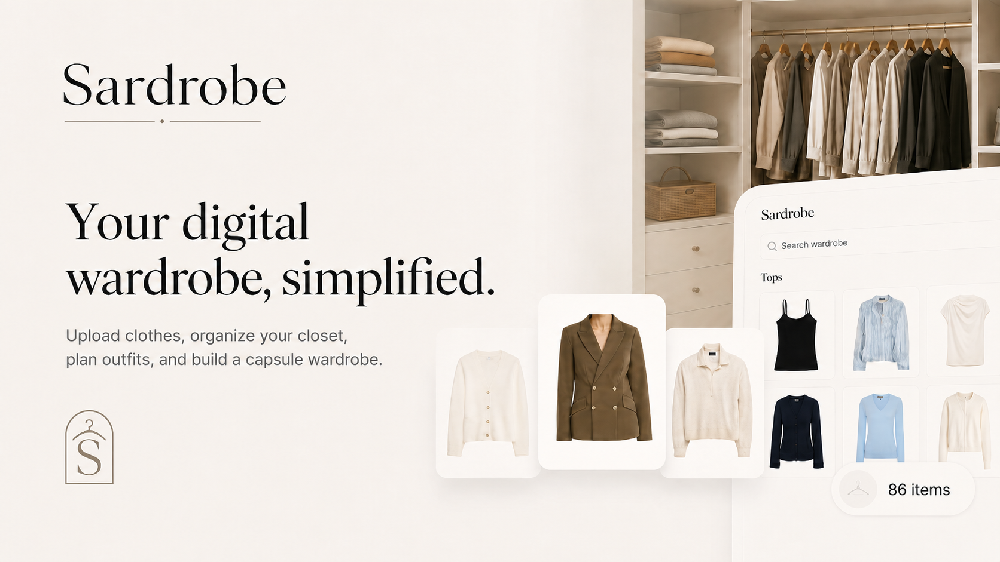

<p align="center">
  
</p>

<h1 align="center">Sardrobe</h1>

<p align="center">
  <strong>Open-source AI digital wardrobe with local image processing.</strong>
</p>

<p align="center">
  <a href="https://sardrobe.com"></a>
  <a href="https://www.producthunt.com/products/sardrobe"></a>
  <a href="#cloudflare-deployment"></a>
  <a href="#on-device-planning-ai"></a>
  <a href="#webmcp"></a>
  <a href="LICENSE"></a>
</p>

<p align="center">
  <a href="#main-functions">Features</a>
  ·
  <a href="#local-installation">Local installation</a>
  ·
  <a href="#cloudflare-deployment">Cloudflare deployment</a>
</p>

<p align="center">
  <a href="https://www.buymeacoffee.com/omarkawach"></a>
</p>



Sardrobe is an open-source digital wardrobe. Use it to catalog clothes, create outfits, and prepare packing lists.

Sardrobe processes original clothing photos in the browser. It uploads only the final WebP cutouts to the configured Cloudflare R2 bucket. If you self-host Sardrobe, the application data stays in your Cloudflare account.

Optional AI functions run in supported desktop browsers. They do not use a hosted model API.

## Main functions

- Import multiple clothing photos.
- Remove photo backgrounds in the browser.
- Review and edit imported items before you save them.
- Add item names, categories, colors, seasons, occasions, brands, and notes.
- Search, filter, group, edit, and delete wardrobe items.
- Arrange wardrobe items on an outfit canvas.
- Save and edit outfits.
- Create packing plans with dates, outfits, items, notes, and packed states.
- Sign in with Google.
- Use native WebMCP tools in a compatible browser and agent.

## WebMCP

Sardrobe registers site tools through the native `document.modelContext` API.

Use one of these environments:

- ChatGPT's in-app browser, which supports WebMCP without additional browser configuration;
- Google Chrome 149 or a later version with `chrome://flags/#enable-webmcp-testing` enabled and a WebMCP-compatible agent.

Restart Chrome after you enable the flag. Chrome without a compatible agent cannot call the tools.

The tools use the same session and server authorization as the user interface. Sardrobe does not require an MCP relay, an extension, or a separate agent credential.

Read the [WebMCP agent guide](apps/frontend/public/.well-known/sardrobe-agent-guide.md) for the tool list and safe workflows.

## On-device planning AI

On-device planning AI is an optional desktop feature. Enable it in the account menu. Sardrobe uses [SmolVLM-500M-Instruct](https://huggingface.co/HuggingFaceTB/SmolVLM-500M-Instruct) for outfit and trip planning.

Transformers.js and the Vercel AI SDK run the selected model with WebGPU.

On-device planning AI can:

- create an outfit draft from a text request and an optional reference image;
- create a packing-plan draft from a text request.

On-device planning AI does not identify, label, or describe wardrobe items. Enter and review item details yourself when importing or editing clothes. Image-based wardrobe recognition is experimental and is intentionally not exposed in the product; a future iteration may evaluate Google's LiteRT-LM image-input support.

The browser cache stores the model files. On-device planning AI is not available on phones or tablets.

Planning results are drafts. Review each outfit or packing plan before you save it.

## Local installation

### Requirements

- Node.js 22.12 or a later version
- pnpm 10
- A Google OAuth web client

### Procedure

1. Install the dependencies.

   ```sh
   pnpm install
   ```

2. Copy the local configuration files.

   ```sh
   cp apps/backend/.dev.vars.example apps/backend/.dev.vars
   cp apps/frontend/.env.example apps/frontend/.env
   ```

3. Add these values to `apps/backend/.dev.vars`:

   - `BETTER_AUTH_SECRET`
   - `GOOGLE_CLIENT_ID`
   - `GOOGLE_CLIENT_SECRET`

   Use this command to make a suitable Better Auth secret:

   ```sh
   openssl rand -hex 32
   ```

4. Add this authorized redirect URI to the Google OAuth client:

   ```text
   http://localhost:4321/api/auth/callback/google
   ```

5. Create the local database.

   ```sh
   pnpm db:migrate:local
   ```

6. Start the application.

   ```sh
   pnpm dev
   ```

7. Open [http://localhost:4321](http://localhost:4321).

`pnpm dev` also serves the exported background-removal model on port 8790. If `packages/background-remover/tooling/build` does not contain the model files, use the [model tooling instructions](packages/background-remover/tooling/README.md).

The [`.mcp.json`](.mcp.json) file is for compatible coding agents. It connects an agent to documentation for Better Auth, Astro, Cloudflare, and Chrome DevTools. Sardrobe does not use this file at runtime.

## Cloudflare deployment

Use the [deployment instructions](docs/DEPLOYMENT.md) to deploy a fork.

The instructions include these tasks:

- provision a D1 database and an R2 media bucket;
- configure Google OAuth and Better Auth;
- export and upload the background-removal model;
- apply database migrations;
- deploy the Workers;
- configure custom domains;
- configure Sentry if you require it.

The public `wrangler.jsonc` files do not contain Sardrobe account IDs, resource IDs, domains, or secrets. Wrangler can provision resources for a different Cloudflare account.

## Technology

- Astro and React
- Hono and Cloudflare Workers
- Cloudflare D1 and R2
- Better Auth and Google OAuth
- Drizzle ORM
- Base UI
- ONNX Runtime Web
- Transformers.js
- Vercel AI SDK
- WebMCP

## Project structure

- `apps/frontend`: Astro site, React application, frontend Worker, and model route
- `apps/backend`: Hono API Worker
- `packages/data-ops`: Better Auth configuration, Drizzle schema, and D1 migrations
- `packages/background-remover`: Browser runtime and model export tools
- `packages/design-tokens`: Shared design tokens
- `packages/react-components`: Shared React components

## Development checks

Install Chromium for the component tests:

```sh
pnpm --filter @sardrobe/react-components exec playwright install chromium
```

Run individual checks:

```sh
pnpm lint
pnpm typecheck
pnpm test
pnpm build
```

Run all checks:

```sh
pnpm check
```

Start Storybook:

```sh
pnpm storybook
```

## Common questions

### Does Sardrobe upload original photos?

No. The browser processes each original photo. Sardrobe uploads only the final WebP cutout to the configured R2 bucket.

### Does Sardrobe require an AI API key?

No. The optional AI model runs in the browser. Google OAuth credentials are necessary for sign-in.

### Can I self-host Sardrobe?

Yes. Fork the repository and use the Cloudflare deployment instructions.

### Can I contribute without access to the Sardrobe Cloudflare account?

Yes. You can install the project and run all checks without access to the official development or production environments. The repository owner deploys accepted changes.

## Contributions and security

Read [CONTRIBUTING.md](CONTRIBUTING.md) before you open a pull request. Participation is governed by the [Code of Conduct](CODE_OF_CONDUCT.md).

Report a vulnerability with a private GitHub security advisory. Read [SECURITY.md](SECURITY.md) for the procedure.

## License

Sardrobe uses the [MIT License](LICENSE).

Read [`packages/background-remover/NOTICE`](packages/background-remover/NOTICE) for background-removal attribution. Read [`apps/frontend/NOTICE`](apps/frontend/NOTICE) for on-device AI attribution. The repository does not contain pretrained model weights.
